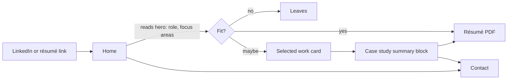
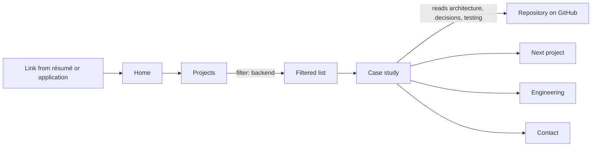
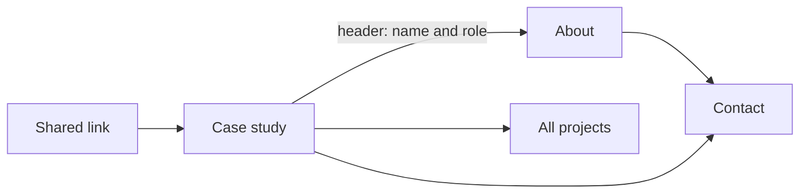
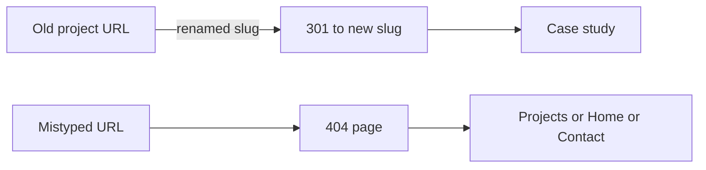
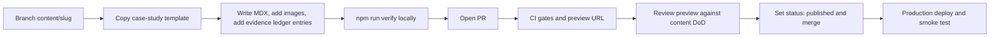

# User flows

> Status: Accepted · Owner: Afran Anas · Last updated: 2026-10-13

These are the critical paths through the site. Flows F1–F4 are covered by E2E tests ([testing strategy](../04-engineering/testing-strategy.md#e2e-flows)), and F1 and F2 are also part of the manual screen-reader pass (NFR-A11Y-04). The click counts below are the maximum allowed. A design change that increases them needs a reason.

## F1: Recruiter quick scan

**Goal:** decide fit and get the résumé or contact details in under 2 minutes, usually on a phone.

| Step | Max clicks from landing | Requirement |
|---|---|---|
| See role and focus areas | 0 | FR-HOME-01 |
| Open the résumé | 1 (header) | FR-GLB-01, FR-RES-01 |
| Reach contact details | 1 | FR-GLB-01 |
| See one project's summary | 1 | FR-HOME-03, FR-CS-02 |

## F2: Hiring manager deep dive

**Goal:** judge technical depth before or after an interview, usually on desktop.

| Step | Max clicks from Home | Requirement |
|---|---|---|
| Reach the filtered project list | 2 | FR-PRJ-04 |
| Reach a case study in the chosen area | 3 | FR-PRJ-03 |
| Reach source code | 4 | FR-CS-02 |
| Move to the next case study | +1 | FR-CS-10 |

## F3: Shared link lands on a case study

**Goal:** a peer or hiring manager arrives with no context and has to orient themselves.

Requirements: FR-GLB-01 (the identity is visible on every page), FR-CS-01, FR-CS-10, and FR-CS-11.

## F4: Broken or old link

Requirements: FR-404-01 and FR-404-02.

## F5: Owner publishes a project

This is not a visitor flow. It is the content workflow that keeps the site maintained (G6).

Requirements: NFR-MAINT-03, [content strategy](../01-product/content-strategy.md#content-lifecycle), and the [definition of done](../05-delivery/definition-of-done.md#content-changes).
