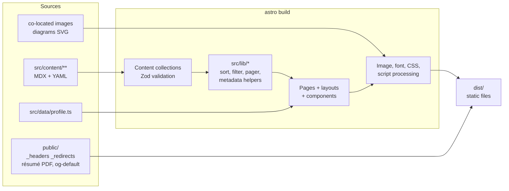

# Application architecture

> Status: Accepted · Owner: Afran Anas · Last updated: 2026-10-13

## Overview

The site is a statically generated Astro site ([ADR-001](adr/ADR-001-rendering-strategy.md), [ADR-002](adr/ADR-002-framework.md)). All the logic runs at **build time**: content is loaded and validated, pages are rendered, and assets are optimized. At **runtime** the browser receives finished HTML plus three small, optional scripts.

Invalid content stops the pipeline at the validation step. Nothing partial is ever emitted.

## Layers and boundaries

| Layer | Location | Responsibility | May depend on |
|---|---|---|---|
| Pages | `src/pages/` | Routing. Fetches data through `src/lib`. Composes layouts and components. | lib, layouts, components, data |
| Layouts | `src/layouts/` | The document shell: `<head>` metadata, header, footer, `main`, and the analytics beacon. | components, lib |
| Components | `src/components/` | Presentation. Gets everything through props and slots, and never fetches data itself. | other components, `src/lib` pure helpers |
| Library | `src/lib/` | Pure TypeScript: sorting, filtering, the pager, area labels, metadata builders, date formatting, env flags. **Unit-tested.** | Nothing in the UI layers |
| Content | `src/content/`, `src/content.config.ts` | Entries and their schemas | — |
| Data | `src/data/profile.ts` | Identity and contact facts (one source) | — |
| Client scripts | `<script>` inside `NavMenu`, `ProjectFilter`, `CopyEmailButton` | Progressive enhancement only | DOM APIs |

**Rules:**

- Components never call `getCollection`. Pages do, through `src/lib`, so data access is in one place and is testable.
- Business rules such as sort order, prev/next neighbors, and which filter options exist are implemented once in `src/lib` and used both by pages and by the client filter script.
- No component imports from `src/pages`.

## Rendering strategy per route

| Route | Generated from | Notes |
|---|---|---|
| `/`, `/projects`, `/experience`, `/about`, `/contact`, `/privacy` | One page file each | — |
| `/projects/[slug]` | `getStaticPaths()` over published projects | Drafts are excluded in production builds |
| `/engineering` | One page file | Built only if FR-ENG-01 is satisfied. Otherwise the page and its nav link are left out (the condition is computed in `src/lib`). |
| 404 | `src/pages/404.astro` → `404.html` | Served with status 404 by the host ([routing](routing-and-page-model.md)) |

Details are in [routing and page model](routing-and-page-model.md).

## Client-side behavior

There are exactly three scripts. Each one is a module scoped to its component and is bundled by Astro.

| Script | Without JavaScript | With JavaScript | Requirement |
|---|---|---|---|
| `NavMenu` | Links are visible and wrap | A collapsible menu below 960 px | FR-GLB-04, FR-GLB-06 |
| `ProjectFilter` | All cards are shown and the filter UI is `hidden` | The script un-hides the filter, applies `?area=`, and handles `popstate` | FR-PRJ-04 to 07 |
| `CopyEmailButton` | The button is `hidden`. The address is visible text. | Clipboard API plus a live-region message | FR-CON-02 |

**Pattern:** the server-rendered HTML is complete and correct. A script finds its root element through a `data-*` attribute and enhances it. If anything throws, the page stays usable in its HTML state. Errors are caught and logged with `console.error`, and the control isn't shown.

## Error handling

| Where | Failure | Handling |
|---|---|---|
| Build | Invalid content (schema) | The build fails, naming the file, field, and rule (NFR-MAINT-03) |
| Build | A broken reference (for example `relatedProjects` points to a missing slug) | The build fails because of `reference()` validation |
| Build | Missing required body sections, or an unknown `ledgerId` | The content test fails in CI |
| Build | An image is missing or invalid | The build fails (Astro asset import) |
| Runtime | Unknown path | The host returns `404.html` with status 404 |
| Runtime | Enhancement script error | The page stays in its no-JavaScript state. The error is logged to the console. |
| Runtime | Analytics blocked or down | No effect on the page |

## Major dependencies

| Dependency | Kind | Purpose |
|---|---|---|
| `astro` | Production (build) | Framework, content collections, images, fonts, Shiki |
| `@astrojs/mdx` | Production (build) | MDX content |
| `@astrojs/sitemap` | Production (build) | `sitemap-index.xml` |
| `typescript`, `@astrojs/check` | Dev | Type checking |
| `eslint`, `typescript-eslint`, `eslint-plugin-astro`, `eslint-plugin-jsx-a11y-x`, `prettier`, `prettier-plugin-astro` | Dev | Linting and formatting |
| `vitest` | Dev | Unit and content tests |
| `@playwright/test`, `@axe-core/playwright` | Dev | E2E and accessibility tests |
| `@lhci/cli` | Not installed (run with pinned `npx` in CI) | Performance budgets ([technology stack](technology-stack.md#quality-tooling)) |
| `wrangler` | Dev | Local production-like serving and deployment |

Nothing is shipped to the browser except the code we write. No runtime library reaches the browser. Versions are recorded in the [technology stack](technology-stack.md).
