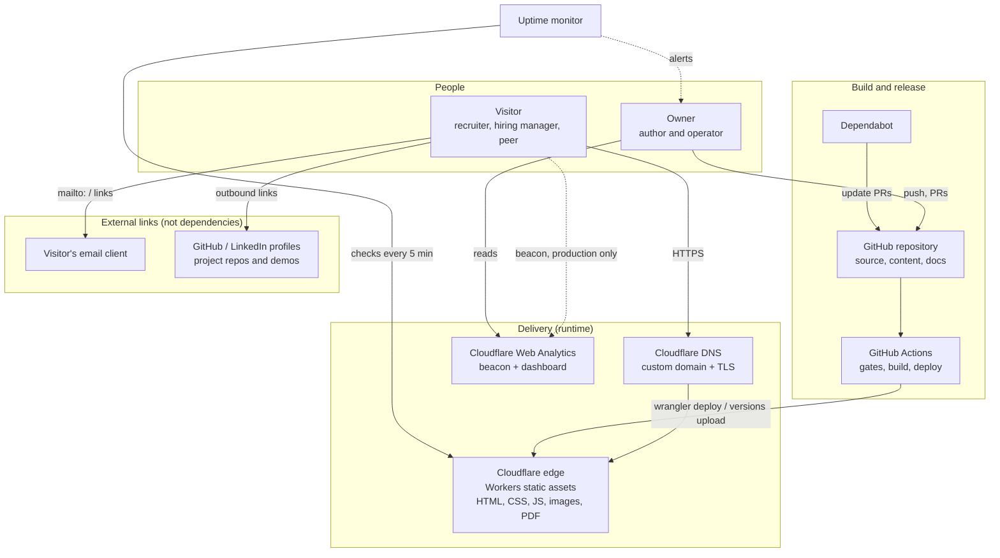

# System context

> Status: Accepted · Owner: Afran Anas · Last updated: 2026-10-13

This document shows the system's boundary and every external dependency, and what happens when each dependency fails.

## Context diagram

There is no server, database, or API owned by this system. The runtime is a set of static files served by the CDN ([ADR-001](adr/ADR-001-rendering-strategy.md)).

## Actors

| Actor | Interaction |
|---|---|
| Visitor | Reads pages over HTTPS, follows links, downloads the résumé, and starts email in their own mail client. |
| Owner | Writes code and content, reviews pull requests and previews, reads analytics, and receives alerts. |

## External dependencies

| Dependency | Role | If it fails | Detection | Recovery |
|---|---|---|---|---|
| Cloudflare Workers (static assets) | Serves the site | The site is down | Uptime monitor alert | Wait for the provider, or redeploy `dist/` to Cloudflare Pages or Netlify ([backup and recovery](../06-operations/backup-and-recovery.md)) |
| Cloudflare DNS | Resolves the domain and issues TLS | The site is unreachable | Uptime monitor | Provider-dependent. DNS records are documented in the [runbook](../06-operations/deployment-runbook.md#dns-records) |
| Domain registrar | Domain ownership | The domain expires and the site is lost | Renewal notices | Auto-renew is on, with a calendar reminder 60 days before expiry |
| GitHub | Source of truth and CI | No deployments. The live site is unaffected. | GitHub status page | Local clones hold the full history. Push to another remote. |
| GitHub Actions | Gates and deploys | No deployments. The live site is unaffected. | Workflow failure emails | Re-run, or deploy manually with `wrangler` from a verified local build (runbook) |
| Cloudflare Web Analytics | Metrics | No metrics. The site is unaffected (the beacon loads with `defer`). | Gap in the dashboard | None needed |
| Uptime monitor | Alerts | No alerts | Monthly check during maintenance | Re-create the monitor |
| npm registry | Dependencies at build time | Builds fail. The live site is unaffected. | CI failure | Retry. The lockfile ensures the same versions. |

**Design rule:** no runtime dependency apart from the host itself. Analytics is optional at runtime. Fonts, images, and scripts are all served from the site's own origin.

## Data flows

| Flow | Data | Personal data? | Notes |
|---|---|---|---|
| Visitor → host | HTTP request: IP address, user agent, path | Yes (IP address) | Processed by Cloudflare as the host. Covered on `/privacy`. |
| Visitor → analytics | Path, referrer, user agent, performance timings | No identifiers are stored | Cookieless ([ADR-007](adr/ADR-007-analytics.md)) |
| Visitor → owner (email) | Whatever the visitor writes | Yes | Handled in the owner's mailbox, outside this system |
| Owner → GitHub → Cloudflare | Source and build output | No | Public repository (C3) |
