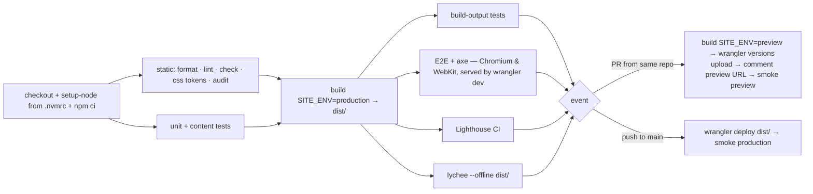

# CI/CD

> Status: Accepted · Owner: Afran Anas · Last updated: 2026-10-13

GitHub Actions is the single pipeline for checking, building, and deploying ([ADR-005](../03-architecture/adr/ADR-005-hosting-and-deployment.md)). **The artifact that passes the gates is the artifact that gets deployed.** The workflow files are created in the Phase 3 walking skeleton. This document is their specification.

## Workflows

### `ci.yml`

**Triggers:** `pull_request` (to `main`) and `push` (to `main`).

**Concurrency:** group `ci-${{ github.ref }}`, with `cancel-in-progress: true` for pull requests. Never cancel a run on `main`, because that could cancel a deploy partway through.

**Default permissions:** `contents: read`.

| Job | Needs | Notes |
|---|---|---|
| `static` | — | Format, lint, `astro check`, CSS token check, `npm audit --audit-level=high` |
| `unit` | — | `vitest run` |
| `build` | static, unit | `SITE_ENV=production` and `CF_WEB_ANALYTICS_TOKEN` from repository variables. Uploads `dist/` as an artifact. |
| `verify-build` | build | Downloads `dist/`, then runs build-output tests, E2E (Playwright browsers cached), Lighthouse CI, and lychee offline. Uploads the Playwright report and Lighthouse results as artifacts when a check fails. |
| `preview` | verify-build | Runs only when `github.event_name == 'pull_request' && github.event.pull_request.head.repo.full_name == github.repository`. Builds with `SITE_ENV=preview`, runs `wrangler versions upload`, posts or updates one pull request comment with the preview URL (needs `pull-requests: write` on this job only), then runs the smoke test in preview mode. |
| `deploy` | verify-build | Runs only on `push` to `main`. GitHub environment `production`. `wrangler deploy` of the downloaded `dist/`, then `node scripts/smoke.mjs https://<domain>`. |

Only the `preview` and `deploy` jobs receive `CLOUDFLARE_API_TOKEN` and `CLOUDFLARE_ACCOUNT_ID`.

### `links.yml`

- **Triggers:** `schedule` (weekly, Monday 06:00 UTC) and `workflow_dispatch`.
- Builds the site, then runs lychee online over `dist/` (`--root-dir dist --fallback-extensions html`, which resolves extensionless internal links). External URLs are retried, and known flaky hosts such as linkedin.com, which blocks bots, are listed in `.lycheeignore` with a comment.
- If it fails, it opens or updates an issue labelled `broken-links`, which needs `issues: write` on this job only.

### `dependabot.yml`

| Ecosystem | Schedule | Grouping |
|---|---|---|
| `npm` | Monthly | Minor and patch updates grouped into one pull request. Major versions get one pull request each. |
| `github-actions` | Monthly | All grouped |

Dependabot pull requests go through `ci.yml` like any other. They are never auto-merged.

## Hardening

- Every third-party action is pinned to a full commit SHA, with the version in a comment: `uses: actions/checkout@<sha> # v5`. Dependabot keeps them updated.
- `permissions:` is set at the workflow level to `contents: read` and raised per job only where needed.
- `pull_request_target` is never used.
- Secrets are never printed, `set -x` is never used in steps that have secrets, and `wrangler` output is not echoed with tokens.
- The production deploy uses a GitHub **environment** called `production`, restricted to the `main` branch.

## Caching

- npm, through `actions/setup-node` with `cache: npm`.
- Playwright browsers, keyed on the Playwright version from the lockfile.
- Nothing else. Build caches are not reused between runs, which keeps builds reproducible.

## Local equivalents

| CI step | Local command |
|---|---|
| Static checks | `npm run format:check && npm run lint && npm run check && npm run check:css` |
| Unit and content tests | `npm test` |
| Build | `npm run build` |
| E2E | `npm run test:e2e` (builds, then serves with `wrangler dev`) |
| Lighthouse | `npm run lhci` |
| Everything | `npm run verify` |

The full script list is in [local development](../06-operations/local-development.md#scripts).

## Failure handling

| Failure | What happens | Owner action |
|---|---|---|
| A gate fails on a pull request | No preview, merging is blocked, artifacts are uploaded | Fix it on the branch |
| A gate fails on `main` (should be rare after a pull request) | No deploy | Fix forward through a pull request, or revert |
| Preview deploy fails | The pull request check is red | Rerun. If Cloudflare is down, wait. |
| Production deploy fails | The previous version keeps serving | Rerun the job. If it keeps failing, follow the [runbook](../06-operations/deployment-runbook.md#manual-deploy). |
| Production smoke test fails | The workflow is red and an email notification is sent | [Roll back](../06-operations/deployment-runbook.md#rollback), then investigate |
| Weekly link check fails | An issue is opened | Fix or remove the link during the weekly review |
